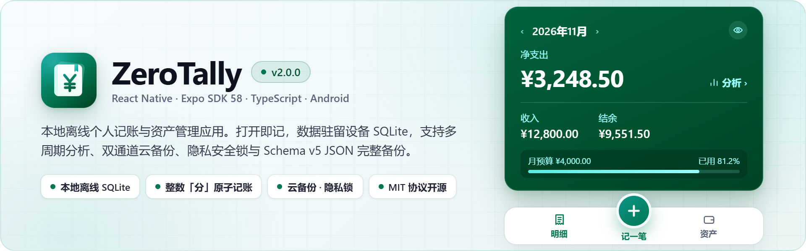
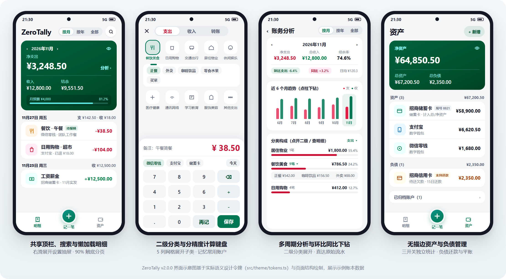
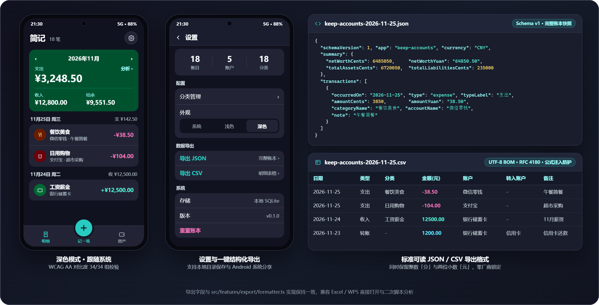
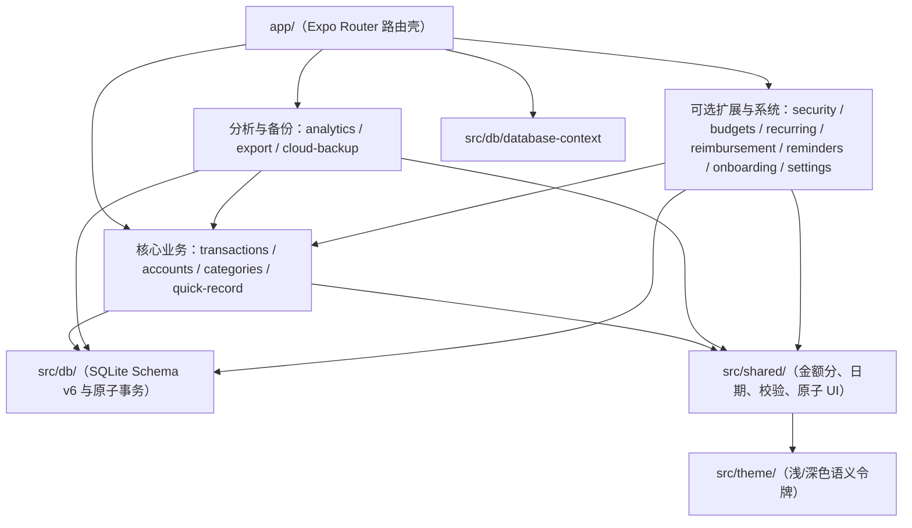
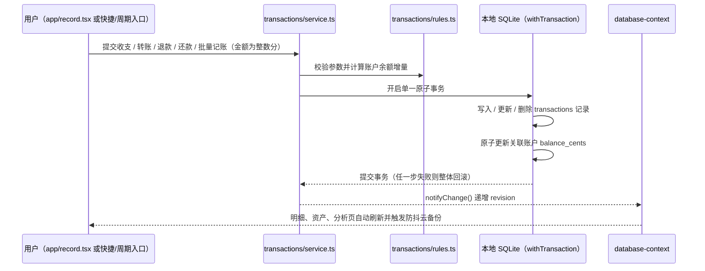

<div align="center">

<picture>
  <source media="(prefers-color-scheme: dark)" srcset="docs/assets/banner-dark.png" />
  <source media="(prefers-color-scheme: light)" srcset="docs/assets/banner-light.png" />
  
</picture>

<br />

[](https://github.com/zerobiubiu/ZeroTally/releases)
[](https://github.com/zerobiubiu/ZeroTally/actions/workflows/ci.yml)
[](https://github.com/zerobiubiu/ZeroTally/actions/workflows/release-apk.yml)
[](LICENSE)
[](https://github.com/zerobiubiu/ZeroTally/releases/latest)
[](bunfig.toml)

<p>
  <a href="#界面预览">界面预览</a> ·
  <a href="#核心能力">核心能力</a> ·
  <a href="#下载安装">下载安装</a> ·
  <a href="#本地开发与构建">本地开发</a> ·
  <a href="#系统架构与数据流">系统架构</a> ·
  <a href="#数据备份格式">备份格式</a> ·
  <a href="#自动构建与发布">自动发包</a> ·
  <a href="#文档与开源协议">项目文档</a>
</p>

</div>

# ZeroTally

ZeroTally `v2.0.0` 是面向 Android 的本地离线个人记账与资产管理应用，基于 React Native（Expo SDK 58 + TypeScript + Expo Router + `expo-sqlite`）开发，采用 MIT 协议开源。

应用围绕五项工程与交互约束构建：

- **本地离线优先与主动授权云备份**：全部账目、账户、分类与设置存储在设备本地 SQLite 数据库（`src/db/`），零第三方统计埋点、无需注册账号；需要跨设备容灾时，可在设置中主动配置 WebDAV 或 Google Drive 双通道云备份，敏感凭据由 `expo-secure-store` 硬件级隔离存储。
- **整数「分」与原子事务**：金额统一以整数「分」（`cents`）解析与计算（[src/shared/money/money.ts](src/shared/money/money.ts)）；支出、收入、转账、关联退款、负债还款、批量记账、平账与级联删户均在单一 SQLite 事务内原子完成并同步余额（[src/features/transactions/service.ts](src/features/transactions/service.ts)）。
- **高频记账与多向手势直达**：底栏采用半高双栏（明细 / 资产）加居中向上凸起的圆形「+ 记一笔」主按钮。短按进入完整记一笔（内置整数分计算键盘与分类账户记忆），长按 `+` 唤出 5 项扇形极速记账，底栏上滑拉出 2x3 快捷记账半屏窗（支持 3 秒圆环原地撤销、单卡长按调金额/切账户与顶栏批量记账入口）；主界面支持左右滑切 Tab，点击共享顶栏标题或在明细页右滑展开左侧设置抽屉。
- **可扩展的零干扰进阶账务**：预算管理、周期账单（固定支出、弹性月薪、等额本息/等额本金房贷与提前还款试算、信用卡日历）、报销追踪、每日本地提醒、原生 Android 4x2 桌面小组件及隐私安全锁均在设置中按需开启，默认关闭，不干扰日常极速记账流程。
- **零锁定完整 JSON 备份与严格发布签名**：支持 Schema v5 完整 JSON 备份导入导出（附 `fnv1a-64-v1` 校验指纹，兼容导入 v1-v4 历史备份）及两级分类树独立 JSON 迁移；本地与 CI 发布均启用严格正式签名门禁与 R8 压缩瘦身。

---

## 界面预览

### 核心功能与浅色模式

<p align="center">
  
</p>

### 深色模式与结构化备份预览

<p align="center">
  
</p>

> 界面示意图基于项目语义设计令牌（[src/theme/tokens.ts](src/theme/tokens.ts)）与布局结构绘制。34 组核心浅色与深色前背景配对均通过 WCAG AA 4.5:1 对比度校验，设计规范见 [src/theme/DESIGN.md](src/theme/DESIGN.md)。

---

## 核心能力

### 基础记账、搜索与资产管理

| 模块 | 能力范围 | 关键业务口径与实现位置 |
| --- | --- | --- |
| 支出、收入与关联退款 | 二级分类网格（18 个一级预设 + 64 个二级预设）、内置整数分加减计算键盘、四层分类账户记忆、单行左滑编辑/复制/删除与关联退款（支持全额、部分、多次与超额退款） | 金额全程整数「分」存储；周期总览退款抵扣净支出，单日小计归入当日收入；删原支出同事务连带删退款并回滚余额（[src/features/transactions/](src/features/transactions/)） |
| 转账与负债还款 | 任意两账户转账并排聚焦双卡、实时余额预览与一键互换；独立负债还款页支持「资产转入还款」与「无账户直接还款」 | 转账与还款均原子联动关联账户余额，且不计入月度收支统计（[app/record.tsx](app/record.tsx)、[app/repayment.tsx](app/repayment.tsx)） |
| 多维搜索与懒加载分页 | 顶栏直达搜索页，支持关键词（备注/分类/账户）、交易类型、分类（含二级）、账户、日期区间与金额区间组合筛选；明细首页与账户详情均采用 90% 触底懒加载（40 条/页） | 搜索条件全量参数化绑定并对 `LIKE` 通配符转义；分页查询解除单账户千笔截断上限，周期汇总在 SQL 层直接聚合（[app/search.tsx](app/search.tsx)、[src/features/transactions/pagination-rules.ts](src/features/transactions/pagination-rules.ts)） |
| 资产与负债账户 | 无描边分组式新增/编辑表单（类型驱动性质、银行卡号 4 位分组与一键复制、内嵌图标面板、`计入总资产`/`计入净资产`/`记账时可选` 三独立开关）；账户详情支持上滑吸顶小卡、悬浮记一笔、平账（可选生成流水）、归档与三重验证级联删除 | 负债欠款存为负净值；总资产按 `includeInTotalAssets` 统计非负余额，净资产与总负债按 `includeInNetWorth` 汇总，归档账户一律排除（[src/features/accounts/](src/features/accounts/)） |
| 快捷记账与批量记账 | 底栏上滑 2x3 快捷半屏窗（自定义模板或近 30 天高频推荐、3 秒圆环倒计时原地撤销、单卡长按上下调金额/左右切账户、全屏编辑）；长按 `+` 唤出 5 项扇形极速记账；快捷顶栏一键进入批量记账页 | 批量记账先全量校验，再经 `createTransactionsBatch` 在单事务内全成功或全回滚提交（[src/features/quick-record/](src/features/quick-record/)、[app/batch-record.tsx](app/batch-record.tsx)） |
| 多周期财务分析 | 按月 / 按年 / 全部维度分析，展示环比/同比增幅、消费节奏洞察、可逐级下钻的趋势柱图、可展开二级分类排行、大额单笔 Top 5 与账户分布 | 点击分类、二级分类或账户可直达 `/search` 查看对应原始流水；点击 Top 5 直接唤出交易详情浮窗（[app/analytics.tsx](app/analytics.tsx)、[src/features/analytics/](src/features/analytics/)） |
| 分类管理与多主题 UI | 居中浮窗新增/编辑、9 大生活主题 146 项双图库图标、同级长按拖拽排序、停用沉底、删除时原子迁移历史账目、分类树独立 JSON 增量合并/覆盖导入导出；系统/浅色/深色主题持久化与全局崩溃恢复边界 | 停用分类仅在新增记账隐藏，不删除历史账务；根级 `AppErrorBoundary` 防止渲染异常白屏闪退并支持脱敏摘要复制（[app/categories.tsx](app/categories.tsx)、[src/shared/ui/](src/shared/ui/)） |

### 隐私安全、备份与可选进阶模块

| 模块 | 能力范围 | 关键边界与实现位置 |
| --- | --- | --- |
| 个性化隐私与安全中心 | 独立组合配置应用启动锁、系统生物识别验证、4-6 位加盐哈希 PIN、后台超时重锁（`0/30/60/300` 秒）、防截屏与后台隐私遮罩、默认隐藏金额与总览卡小眼睛开关 | 全部安全项默认关闭；PIN 仅以加盐多轮 SHA-256 存入 `expo-secure-store`，绝不落入 SQLite（[app/security.tsx](app/security.tsx)、[src/features/security/](src/features/security/)） |
| 本地备份与双通道云备份 | 本地导出/校验预览/原子覆盖导入 Schema v5 JSON 备份、4 位验证码清空账本；云备份支持 WebDAV（默认强制 HTTPS）与 Google Drive（OAuth 2.0 PKCE `S256` + `drive.file` 最小权限）、多版本快照恢复与 15 秒防抖自动云备份 | 恢复快照与清空账本自动抑制回传防循环覆盖；云盘密码与 OAuth Token 由硬件加密凭据仓储隔离（[app/advanced-settings.tsx](app/advanced-settings.tsx)、[app/cloud-backup.tsx](app/cloud-backup.tsx)） |
| 可选月度预算 | 设置按需开启月总预算、预警阈值与一级支出分类月预算，开启后在明细按月总览卡底部展示单行轻量进度条 | 默认关闭零干扰；按当月扣退款后的净支出实时判定安全/预警/超支状态（[app/budgets.tsx](app/budgets.tsx)、[src/features/budgets/](src/features/budgets/)） |
| 周期账单与房贷中心 | 设置侧栏一级入口，支持固定周期自动/手动幂等入账、弹性月薪（提前/延时到账及扣款/补贴实发核算）、等额本息/等额本金房贷与提前还款精确试算（应结利息、次月新月供本息拆解、省息对比）及信用卡账单/还款日历 | 计划存于 `app_settings` 零 Schema 侵入；周期键幂等防重，入账委托核心交易服务原子联动余额（[app/recurring.tsx](app/recurring.tsx)、[src/features/recurring/](src/features/recurring/)） |
| 可选报销追踪 | 设置按需开启报销中心，挑选近期支出标记待报销，支持「关联退款抵扣原支出」或「独立报销收入」双口径核销入账；开启后在交易详情附单行报销入口 | 默认关闭零干扰；原支出被删除时自动清理失效报销索引（[app/reimbursements.tsx](app/reimbursements.tsx)、[src/features/reimbursement/](src/features/reimbursement/)） |
| 每日提醒与桌面小组件 | 设置按需开启本地每日定时记账提醒（自定义时段与文案，点击通知直达 `/record`）；配套原生 Kotlin Android 4x2 桌面小组件实时展示当月净支出、收入与 `+ 记一笔` 快捷入口 | 未开启提醒不索要系统通知权限；桌面小组件零三方依赖直读本地 SQLite，并尊重隐私隐藏金额设置（[app/reminders.tsx](app/reminders.tsx)、[plugins/with-android-quick-widget.js](plugins/with-android-quick-widget.js)） |
| 首启轻量引导与手势速查 | 首次启动展示一次性 4 项核心手势提示卡，设置内置「手势与快捷技巧」完整速查页 | 共享单一数据源手势目录，关闭后写入已读标记不再打扰（[app/gestures-guide.tsx](app/gestures-guide.tsx)、[src/features/onboarding/](src/features/onboarding/)） |

---

## 下载安装

前往 [GitHub Releases](https://github.com/zerobiubiu/ZeroTally/releases/latest) 下载正式签名的 Android 安装包与校验文件：

1. 下载最新 `ZeroTally-v2.0.0-android.apk`（默认包含 `arm64-v8a` 与 `x86_64` 双架构，开启 R8 压缩瘦身，体积约 `57.7 MB`）。
2. 可选：下载同目录下的 `.sha256` 文件核对安装包完整性：

```bash
sha256sum -c ZeroTally-v2.0.0-android.apk.sha256
```

3. 在 Android 设备上打开 APK 完成安装（首次侧载需在系统设置中允许安装未知来源应用）。

> 若设备此前安装的是早期 `v0.1.0` 调试签名版，请先在旧版「设置 -> 高级设置」中导出完整 JSON 备份，卸载旧版后再安装正式签名的 `v2.0.0` 并导入恢复。从 `v2.0.0` 起，后续所有正式版本均使用同一长期发布签名，支持直接原地覆盖升级。

---

## 本地开发与构建

### 技术栈与运行环境

| 类别 | 选型与要求 | 说明 |
| --- | --- | --- |
| 应用框架 | React Native `0.88.1` + Expo SDK `58` + Expo Router `58` + React `19.3` | 文件路由、手势导航与三项原生 Expo Config Plugin（[app.json](app.json)） |
| 语言与校验 | TypeScript `6` + ESLint `9` + Vitest `5` | 使用 Node 内置 `node:sqlite` 运行数据库、规则与服务层全量单测 |
| 本地存储与安全 | `expo-sqlite` + `expo-secure-store` + `expo-local-authentication` + `expo-screen-capture` + `expo-notifications` | 参数化 SQL 绑定、单一事务抽象与硬件加密凭据隔离（[src/db/types.ts](src/db/types.ts)） |
| 包管理器 | Bun `1.2+`（验证环境 `1.4.5`） | 通过 [bunfig.toml](bunfig.toml) 开启 `linker = "hoisted"` 适配 RN 与 CMake |
| 运行与构建环境 | Node.js `22+`（验证环境 `26`）；Android Studio / SDK + JDK `21` 或 `25` | 仅在本地打包 APK、生成 Keystore 或启动模拟器时需要 Android SDK 与 JDK |

### 安装、校验与正式签名打包

```bash
# 1. 安装依赖
bun install

# 2. 运行全量质量门禁（版本同步检查 + TypeScript + ESLint + 36 组 / 139 条 Vitest 单测）
bun run verify

# 3. 启动 Expo 开发服务
bun run start

# 4. 首次在仓库外生成正式发布 Keystore（默认 ~/.zerotally-keys/，同步写入受忽略的 signing.local.json）
bun run keystore:init

# 5. 构建正式签名 Android Release APK（默认 arm64-v8a + x86_64，开启 R8 瘦身）
bun run build:apk

# 6. 仅构建主流真机 arm64-v8a 架构（包体更小）
bun run build:apk -- --abis arm64-v8a

# 7. 本机无正式 Keystore 时显式放行调试签名快速自测（严禁对外分发）
bun run build:apk -- --allow-debug-signing
```

本地构建完成后，APK 输出至 `android/app/build/outputs/apk/release/app-release.apk`。Windows 下解决 CMake / Ninja 路径长度限制的原生插件机制见 [plugins/with-windows-cmake-path-fix.js](plugins/with-windows-cmake-path-fix.js) 与排查记录 [docs/troubleshooting/0001-windows-android-apk-build.md](docs/troubleshooting/0001-windows-android-apk-build.md)。

---

## 系统架构与数据流

应用采用「按业务职责组织模块 + 薄路由入口 + 单一本地 SQLite 事务层」设计，使规则变更收敛在对应职责目录内。完整规则归属索引与用例导航见 [docs/architecture/overview.md](docs/architecture/overview.md)。

### 模块依赖边界



核心硬性约束：`accounts` 与 `categories` 互相独立且禁止反向依赖 `transactions`；`shared/` 禁止依赖 `features/` 或 `db/`；`app/` 路由文件禁止直连 SQL 或绕过服务层改余额。

### 记账原子事务数据流



### 目录结构速览

```text
ZeroTally/
├── app/                         # Expo Router 文件路由（主双 Tab 及 20+ 二级功能页）
├── src/
│   ├── db/                      # SqlExecutor 抽象、Schema v6 迁移、幂等种子与 Expo/Node 适配器
│   ├── features/
│   │   ├── transactions/        # 支出/收入/转账/退款/还款/批量记账、分页懒加载与多维搜索
│   │   ├── accounts/            # 资产与负债账户管理、净资产汇总、银行卡格式化与三重删除流
│   │   ├── categories/          # 二级预设与自定义分类、拖拽排序、原子迁账与独立 JSON 迁移
│   │   ├── quick-record/        # 快捷半屏窗、扇形极速记账、长按微调与 3 秒圆环撤销
│   │   ├── analytics/           # 多周期分析、环比同比、消费洞察、分类展开与大额 Top 5
│   │   ├── export/              # Schema v5 完整 JSON 备份生成、FNV-1a 校验与单事务恢复
│   │   ├── cloud-backup/        # WebDAV / Google Drive 双通道快照备份与自动防抖同步
│   │   ├── security/            # 应用启动锁、生物识别、加盐 PIN、防截屏与金额隐私脱敏
│   │   ├── budgets/             # 设置可选月度总预算与分类预算管理
│   │   ├── recurring/           # 固定支出、弹性月薪、等额本息/本金房贷与信用卡日历
│   │   ├── reimbursement/       # 设置可选待报销/已报销追踪与双口径核销
│   │   ├── reminders/           # 设置可选每日本地定时提醒调度与点击跳转
│   │   ├── onboarding/          # 首次启动轻量引导与手势快捷技巧目录
│   │   ├── settings/            # 侧边设置抽屉、复用设置面板、验证码清空弹窗与配置仓储
│   │   └── navigation/          # Expo Router 双页 Tab 规范化与共享顶栏抽屉上下文
│   ├── shared/                  # 金额分工具、日期工具、FNV-1a 校验、触觉反馈、原子 UI 与错误边界
│   └── theme/                   # 浅/深色语义令牌与 DESIGN.md 设计规范
├── assets/                      # 应用图标、Android 三层自适应图标与品牌矢量源图
├── plugins/                     # Expo Config Plugin（CMake 短路径、严格签名与 R8、原生 4x2 小组件）
├── scripts/                     # 版本一致性门禁、仓库外 Keystore 生成与本地 APK 构建脚本
├── .github/workflows/           # GitHub Actions CI 与严格签名 Release APK 自动发包流水线
└── docs/                        # 架构说明、技术决策、52 份演进变更记录、排查文档与预览资源
```

---

## 数据备份格式

备份导出由 [src/features/export/formatter.ts](src/features/export/formatter.ts) 实现，支持导出标准 2 空格缩进的完整 JSON 备份（Schema v5，含外观主题、账户三开关与卡信息、二级分类、快捷模板、含退款与还款的全量交易及 `fnv1a-64-v1` 校验指纹），支持跨版本兼容导入 Schema v1-v5，并额外支持分类树独立 JSON 导入导出（[src/features/categories/portability.ts](src/features/categories/portability.ts)）。

<details>
<summary>展开查看完整账本 JSON（Schema v5）结构示例</summary>

文件默认命名为 `ZeroTally-YYYY-MM-DD.json`，每笔金额同时输出精确整数 `*Cents` 与两位小数展示字符串 `*Yuan`（导入恢复严格以 `*Cents` 为准）：

```json
{
  "schemaVersion": 5,
  "app": "ZeroTally",
  "kind": "full-backup",
  "currency": "CNY",
  "exportedAt": "2026-11-27T13:30:00.000Z",
  "integrity": {
    "algorithm": "fnv1a-64-v1",
    "checksum": "a1b2c3d4e5f60708"
  },
  "settings": {
    "themePreference": "system"
  },
  "summary": {
    "netWorthCents": 6485050,
    "netWorthYuan": "64850.50",
    "totalAssetsCents": 6720050,
    "totalAssetsYuan": "67200.50",
    "totalLiabilitiesCents": 235000,
    "totalLiabilitiesYuan": "2350.00",
    "accountCount": 5,
    "categoryCount": 82,
    "quickTemplateCount": 4,
    "transactionCount": 18
  },
  "accounts": [ ... ],
  "categories": [ ... ],
  "quickTemplates": [ ... ],
  "transactions": [
    {
      "id": "tx_01",
      "occurredOn": "2026-11-27",
      "type": "expense",
      "typeLabel": "支出",
      "amountCents": 3850,
      "amountYuan": "38.50",
      "categoryId": "cat_exp_food",
      "categoryName": "餐饮美食",
      "parentCategoryName": null,
      "accountId": "acc_wechat",
      "accountName": "微信零钱",
      "toAccountId": null,
      "toAccountName": null,
      "refundOfId": null,
      "refundedCents": 0,
      "note": "午餐简餐",
      "createdAt": "2026-11-27T04:15:00.000Z",
      "updatedAt": "2026-11-27T04:15:00.000Z"
    }
  ]
}
```

</details>

---

## 自动构建与发布

仓库配置了两套最小权限 GitHub Actions 工作流：

- **持续校验（[.github/workflows/ci.yml](.github/workflows/ci.yml)）**：推送至 `main` 或发起 Pull Request 时运行 `bun install --frozen-lockfile` 与 `bun run verify`。
- **Release APK 自动发包（[.github/workflows/release-apk.yml](.github/workflows/release-apk.yml)）**：推送 `v*` 标签（如 `v2.0.0`）时，自动完成质量门禁、`expo prebuild`、严格正式签名门禁检查、R8 瘦身编译、`apksigner` 验签、生成 `.sha256` 校验文件，并按 [CHANGELOG.md](CHANGELOG.md) 对应版本节创建或更新 GitHub Release。

<details>
<summary>正式发布签名门禁配置（Tag 发布必需的 4 项 Actions Secrets）</summary>

`v*` 标签发版强制校验以下 4 项 Repository Secrets，缺失时主动拦截失败以杜绝误发调试签名包；仅在手动 `workflow_dispatch` 演练且显式勾选 `allow_debug_signing` 时才允许临时调试签名构建（不创建 Release）：

| Secret 名称 | 用途 |
| --- | --- |
| `ANDROID_KEYSTORE_BASE64` | 正式 `.keystore` 文件的 Base64 编码内容（可由 `bun run keystore:init` 生成） |
| `ANDROID_KEYSTORE_PASSWORD` | Keystore 仓库密码 |
| `ANDROID_KEY_ALIAS` | 签名密钥别名 |
| `ANDROID_KEY_PASSWORD` | 签名密钥密码 |

</details>

---

## 文档与开源协议

| 文档 | 内容说明 |
| --- | --- |
| [docs/README.md](docs/README.md) | 文档中心总索引与文档规范 |
| [docs/architecture/overview.md](docs/architecture/overview.md) | 系统架构、模块边界、核心规则权威归属与用例导航 |
| [src/theme/DESIGN.md](src/theme/DESIGN.md) | 色彩令牌、排版尺度与 WCAG 无障碍对比度规范 |
| [docs/troubleshooting/0001-windows-android-apk-build.md](docs/troubleshooting/0001-windows-android-apk-build.md) | Windows 本地构建 CMake / Ninja 路径限制排查记录 |
| [CHANGELOG.md](CHANGELOG.md) | 全量版本演进日志（`v0.1.0` 至 `v2.0.0`） |
| [AGENTS.md](AGENTS.md) | 仓库研发、版本与 AOCI 认知维护规范 |

本项目基于 [MIT License](LICENSE) 开源，欢迎提 Issue、提交 Pull Request 或基于源码自行二次构建。
