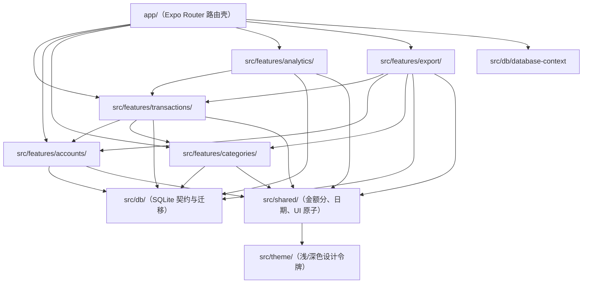
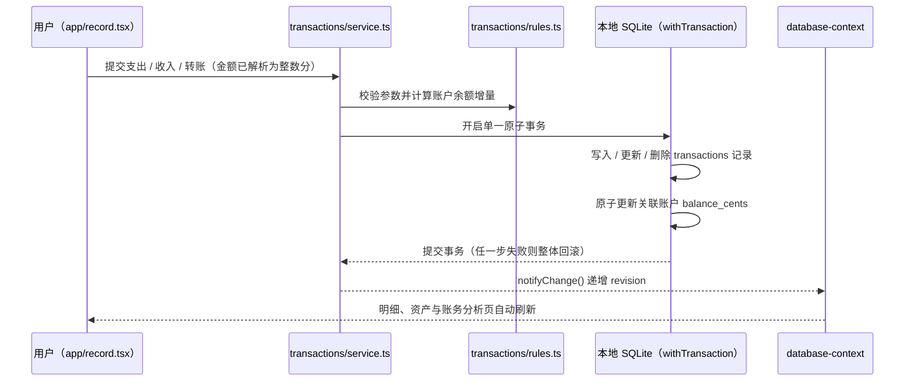

<div align="center">

<picture>
  <source media="(prefers-color-scheme: dark)" srcset="docs/assets/banner-dark.png" />
  <source media="(prefers-color-scheme: light)" srcset="docs/assets/banner-light.png" />
  
</picture>

<br />

[](https://github.com/zerobiubiu/ZeroTally/releases)
[](https://github.com/zerobiubiu/ZeroTally/actions/workflows/ci.yml)
[](https://github.com/zerobiubiu/ZeroTally/actions/workflows/release-apk.yml)
[](LICENSE)
[](https://github.com/zerobiubiu/ZeroTally/releases/latest)
[](bunfig.toml)

<p>
  <a href="#界面预览">界面预览</a> ·
  <a href="#核心能力">核心能力</a> ·
  <a href="#下载安装">下载安装</a> ·
  <a href="#本地开发与构建">本地开发</a> ·
  <a href="#系统架构与数据流">系统架构</a> ·
  <a href="#数据导出格式">数据导出</a> ·
  <a href="#自动构建与发布">自动发包</a> ·
  <a href="#文档与开源协议">项目文档</a>
</p>

</div>

# ZeroTally（简记）

ZeroTally（应用内中文名「简记」）是面向 Android 的本地离线个人记账与资产管理应用，基于 React Native（Expo SDK 58 + TypeScript + Expo Router + `expo-sqlite`）开发，采用 MIT 协议开源。

设计重点聚焦在四个工程与交互约束上：

- **本地离线存储**：全部账目、账户与分类存储在设备本地 SQLite 数据库（`src/db/`），无需注册账号，不上传任何账务数据。
- **整数「分」与原子事务**：金额统一以整数「分」（`cents`）解析与存储（`src/shared/money/money.ts`），记账、改账、删账与账户余额更新在单一 SQLite 事务内原子完成（`src/features/transactions/service.ts`）。
- **高频记账优先布局**：底栏采用半高双栏（明细 / 资产）加居中向上凸起的圆形「+ 记一笔」主按钮，设置入口收敛至顶栏右上角；全部页面通过 `SafeScreen` 隔离刘海屏、挖孔屏与手势导航条区域。
- **零锁定结构化导出**：支持一键导出标准缩进 JSON（完整账本快照）与 UTF-8 BOM CSV（兼容 Excel / WPS，含公式注入防护），可保存至本地文件夹或调用系统分享。

---

## 界面预览

### 核心功能与浅色模式

<p align="center">
  
</p>

### 深色模式与标准结构化导出

<p align="center">
  
</p>

> 以上界面示意图依据项目设计令牌（[src/theme/tokens.ts](src/theme/tokens.ts)）与页面布局结构构建，展示示例账本数据。全部 34 组浅色与深色前背景色彩配对均通过 WCAG AA 4.5:1 对比度校验，详细视觉规范见 [src/theme/DESIGN.md](src/theme/DESIGN.md)。

---

## 核心能力

| 模块 | 能力范围 | 关键业务口径与实现位置 |
| --- | --- | --- |
| 支出与收入记账 | 录入金额、日期、备注与账户；内置 11 个支出分类、7 个收入分类，支持自定义分类与账目编辑删除 | 金额以整数「分」存储；编辑或删除自动回滚并重算关联账户余额（[src/features/transactions/](src/features/transactions/)） |
| 账户间转账 | 任意两账户间资金划转（含储蓄卡还信用卡），支持一键互换转出与转入账户 | 计入账单流水并原子联动两端余额，不计入月度支出或收入统计（[src/features/transactions/rules.ts](src/features/transactions/rules.ts)） |
| 资产与负债管理 | 预设微信零钱、支付宝、银行储蓄卡、现金与信用卡 5 个账户；支持新增、余额校准、归档与恢复 | 负债欠款以负数净值存储，实时汇总总资产、总负债与净资产（[src/features/accounts/](src/features/accounts/)） |
| 月度账务分析 | 点击明细页顶部月度总览卡直达分析页；展示近 6 个月趋势、分类占比排行、账户分布、日均支出与结余率 | 支持点击 6 月趋势柱快速切月，支持支出构成与收入构成双维度切换（[app/analytics.tsx](app/analytics.tsx)） |
| 标准数据导出 | 在设置页导出标准缩进 JSON（完整账本）与 UTF-8 BOM RFC 4180 CSV（明细表格） | 支持 Android 本地目录保存与系统分享，CSV 自动对 `= + - @` 开头自由文本做公式注入防护（[src/features/export/](src/features/export/)） |
| 分类与主题设置 | 管理自定义分类与使用中分类归档保护；支持系统 / 浅色 / 深色三态切换与账本重置 | 已被历史账目引用的分类仅允许归档停用，防止历史明细丢失名称（[src/features/categories/](src/features/categories/)） |
| 品牌图标与系统适配 | 配套深玉青矢量 Logo、Android 三层自适应图标与 Android 13+ Material You 单色主题图标 | 全页面异形屏安全区隔离，可交互控件满足 Android 48dp 最小触控热区（[assets/brand/](assets/brand/)） |

---

## 下载安装

直接前往 [GitHub Releases](https://github.com/zerobiubiu/ZeroTally/releases/latest) 下载对应版本的 Android 安装包与校验文件：

1. 下载最新 `ZeroTally-v<版本>-android.apk`（当前 `v0.1.0` 默认包含 `arm64-v8a` 与 `x86_64` 双架构，体积约 55 MB）。
2. 可选：下载同目录下的 `.sha256` 文件校验安装包完整性：

```bash
sha256sum -c ZeroTally-v0.1.0-android.apk.sha256
```

3. 在 Android 设备上打开 APK 完成安装。未配置正式发布签名密钥时，Release 产物使用默认本地调试签名，首次安装需在系统设置中允许安装未知来源应用。

---

## 本地开发与构建

### 技术栈与运行环境

| 类别 | 选型与要求 | 说明 |
| --- | --- | --- |
| 应用框架 | React Native `0.88.1` + Expo SDK `58` + Expo Router `58` | 文件路由与原生配置插件（[app.json](app.json)） |
| 语言与校验 | TypeScript `6` + ESLint `9` + Vitest `5` | 使用 Node 内置 `node:sqlite` 运行数据库与服务层单测 |
| 本地数据库 | `expo-sqlite` | 参数化 SQL 绑定与单一事务抽象（[src/db/types.ts](src/db/types.ts)） |
| 包管理器 | Bun `1.2+`（验证环境 `1.4.5`） | 通过 [bunfig.toml](bunfig.toml) 开启 `linker = "hoisted"` 适配 RN 与 CMake |
| 运行与构建环境 | Node.js `22+`（验证环境 `26`）；Android Studio / SDK + JDK `21` 或 `25` | 仅在本地打包 APK 或启动模拟器时需要 Android SDK 与 JDK |

### 安装、校验与打包

```bash
# 1. 安装依赖
bun install

# 2. 运行完整质量门禁（版本同步检查 + TypeScript + ESLint + 12 组 Vitest 单测）
bun run verify

# 3. 启动 Expo 开发服务
bun run start

# 4. 打本地独立 Android Release APK（默认 arm64-v8a + x86_64）
bun run build:apk

# 5. 仅打主流真机 arm64-v8a 架构（包体更小）
bun run build:apk --abis arm64-v8a
```

本地打包完成后，APK 输出至 `android/app/build/outputs/apk/release/app-release.apk`。Windows 下解决 CMake / Ninja 路径长度限制的原生插件机制见 [plugins/with-windows-cmake-path-fix.js](plugins/with-windows-cmake-path-fix.js) 与排查记录 [docs/troubleshooting/0001-windows-android-apk-build.md](docs/troubleshooting/0001-windows-android-apk-build.md)。

---

## 系统架构与数据流

应用采用「按业务职责划分模块 + 薄路由入口 + 单一本地 SQLite 事务层」设计，将业务规则、数据读写与页面视图收敛在各自职责目录内。完整规则索引与变更场景验证见 [docs/architecture/overview.md](docs/architecture/overview.md)。

### 模块依赖边界



### 记账原子事务数据流



### 目录结构速览

```text
ZeroTally/
├── app/                         # Expo Router 文件路由（明细、资产、记账、分析、设置、账户、分类）
├── src/
│   ├── db/                      # SqlExecutor 抽象、Schema 迁移、幂等种子数据与 Expo/Node 适配器
│   ├── features/
│   │   ├── transactions/        # 支出/收入/转账记账、余额联动规则与按月流水
│   │   ├── accounts/            # 资产与负债账户管理、净资产汇总与余额校准
│   │   ├── categories/          # 预设与自定义分类、引用删除保护
│   │   ├── analytics/           # 月度收支指标、近 6 月趋势、分类与账户占比聚合
│   │   └── export/              # 标准 JSON / UTF-8 BOM CSV 生成与原生文件保存/分享
│   ├── shared/                  # 金额「分」工具、日期工具、异形屏 SafeScreen 与基础 UI
│   └── theme/                   # 浅/深色语义令牌与 DESIGN.md 设计规范
├── assets/                      # 应用图标、Android 三层自适应图标与 SVG 品牌源图
├── plugins/                     # Expo Config Plugin（Windows CMake/Ninja 路径长度兼容）
├── scripts/                     # 版本一致性门禁与本地 APK 构建脚本
├── .github/workflows/           # GitHub Actions CI 与 Release APK 自动发包流水线
└── docs/                        # 架构说明、技术决策、变更记录、排查文档与 README 视觉资源
```

---

## 数据导出格式

设置页导出功能由 [src/features/export/formatter.ts](src/features/export/formatter.ts) 实现，支持将完整账本保存至手机目录或通过系统分享发出，确保数据随时可迁移、可备份、可用于表格或脚本分析。

<details>
<summary>展开查看标准 JSON（Schema v1）与 CSV 字段结构示例</summary>

**1. 完整账本 JSON（`keep-accounts-YYYY-MM-DD.json`，2 空格缩进）**

同时输出精确整数 `Cents` 与两位小数字符串 `Yuan`，便于程序无损读取或人工核对：

```json
{
  "schemaVersion": 1,
  "app": "keep-accounts",
  "currency": "CNY",
  "exportedAt": "2026-11-25T13:30:00.000Z",
  "summary": {
    "netWorthCents": 6485050,
    "netWorthYuan": "64850.50",
    "totalAssetsCents": 6720050,
    "totalAssetsYuan": "67200.50",
    "totalLiabilitiesCents": 235000,
    "totalLiabilitiesYuan": "2350.00",
    "accountCount": 5,
    "categoryCount": 18,
    "transactionCount": 18
  },
  "accounts": [ ... ],
  "categories": [ ... ],
  "transactions": [
    {
      "id": "tx_01",
      "occurredOn": "2026-11-25",
      "type": "expense",
      "typeLabel": "支出",
      "amountCents": 3850,
      "amountYuan": "38.50",
      "categoryId": "cat_exp_food",
      "categoryName": "餐饮美食",
      "accountId": "acc_wechat",
      "accountName": "微信零钱",
      "toAccountId": null,
      "toAccountName": null,
      "note": "午餐简餐",
      "createdAt": "2026-11-25T04:15:00.000Z"
    }
  ]
}
```

**2. 账单明细 CSV（`keep-accounts-YYYY-MM-DD.csv`，UTF-8 BOM + RFC 4180）**

表头固定为 8 列：`日期,类型,分类,金额(元),账户,转入账户,备注,记录ID`。支出金额带负号前缀，收入与转账为正数；对分类、账户、备注等自由文本字段自动拦截 `=`、`+`、`-`、`@` 开头的表格公式注入风险。

</details>

---

## 自动构建与发布

仓库配置了两套最小权限 GitHub Actions 工作流：

- **持续校验（[.github/workflows/ci.yml](.github/workflows/ci.yml)）**：在推送至 `main` 或发起 Pull Request 时自动运行 `bun install --frozen-lockfile` 与 `bun run verify`。
- **Release APK 自动发包（[.github/workflows/release-apk.yml](.github/workflows/release-apk.yml)）**：推送 `v*` 标签（如 `v0.1.0`）或在 Actions 页面手动触发时，自动完成质量门禁、`expo prebuild`、编译 Android Release APK、生成 `.sha256` 校验文件并创建或更新 GitHub Release。

<details>
<summary>配置正式发布签名（可选 Actions Secrets）</summary>

如需在云端使用独立正式密钥签名 APK，在仓库 `Settings -> Secrets and variables -> Actions` 添加以下 4 个 Secrets，流水线会自动通过 Android `apksigner` 完成签名并即时清理临时密钥文件：

| Secret 名称 | 用途 |
| --- | --- |
| `ANDROID_KEYSTORE_BASE64` | 正式 `.keystore` / `.jks` 文件的 Base64 编码内容 |
| `ANDROID_KEYSTORE_PASSWORD` | Keystore 仓库密码 |
| `ANDROID_KEY_ALIAS` | 签名密钥别名 |
| `ANDROID_KEY_PASSWORD` | 签名密钥密码 |

</details>

---

## 文档与开源协议

| 文档 | 内容说明 |
| --- | --- |
| [docs/README.md](docs/README.md) | 文档中心总索引与文档规范 |
| [docs/architecture/overview.md](docs/architecture/overview.md) | 系统架构、模块边界、核心规则权威归属与用例导航 |
| [src/theme/DESIGN.md](src/theme/DESIGN.md) | 色彩令牌、排版尺度与 WCAG 无障碍对比度规范 |
| [docs/troubleshooting/0001-windows-android-apk-build.md](docs/troubleshooting/0001-windows-android-apk-build.md) | Windows 本地构建 CMake / Ninja 路径限制排查记录 |
| [CHANGELOG.md](CHANGELOG.md) | 版本变更日志 |
| [AGENTS.md](AGENTS.md) | 仓库研发与版本管理规范 |

本项目基于 [MIT License](LICENSE) 开源，欢迎提 Issue、提交 Pull Request 或基于源码自行二次构建。
