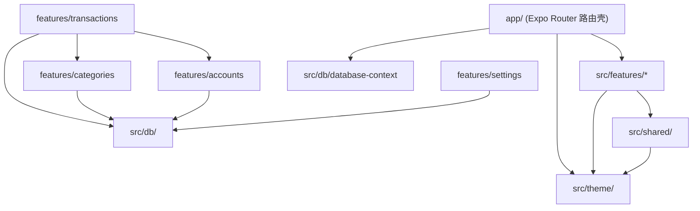

# 系统架构与模块边界说明

- **状态**：参考
- **影响范围**：全项目（`app/`、`src/`）
- **生效版本**：v0.1.0

## 结论概览

本应用采用「按业务职责组织模块 + 薄路由入口 + 单一本地 SQLite 事务层」的架构，核心目标是保证变更局部性：当收支规则、资产汇总口径或分类管理变化时，改动收敛在对应职责目录内，不波及无关模块。

## 目录与职责索引

| 目录 | 为何存在 | 负责什么 | 不负责什么 | 允许谁依赖 |
| --- | --- | --- | --- | --- |
| `app/` | Expo Router 文件路由入口 | 导航装配、参数读取、页面壳 | SQL 访问、业务校验、余额计算 | 仅 Expo Router 运行时 |
| `src/features/transactions/` | 收支与转账核心职责 | 支出/收入/转账记账、编辑删除、余额联动规则、按月流水与日分组汇总、记账表单与明细组件 | 账户净资产汇总、分类 CRUD | `app/`、`analytics`、`export` |
| `src/features/accounts/` | 资产与负债账户职责 | 账户增改、归档恢复、余额校准、总资产/总负债/净资产汇总规则、资产页组件 | 交易流水写入、分类规则 | `app/`、`transactions`、`export` |
| `src/features/categories/` | 收支分类职责 | 预设分类种子、自定义分类增删改、使用中分类删除保护、分类选择组件 | 账目记账、账户余额 | `app/`、`transactions`、`export` |
| `src/features/analytics/` | 月度账务分析职责 | 分类占比排行、账户资金分布、日均支出、结余率与近 6 个月收支趋势聚合 | 交易写入、余额变更 | `app/` |
| `src/features/export/` | 结构化数据导出职责 | 标准缩进 JSON 与 UTF-8 BOM RFC 4180 CSV（含公式注入防护）生成及 Android 目录保存/系统分享 | 业务数据修改 | `app/` |
| `src/features/settings/` | 应用设置与账本概览职责 | 版本与数据统计展示、账本重置入口、设置页组件 | 核心账目与资产业务规则 | `app/` |
| `src/db/` | 本地数据库基础设施 | `SqlExecutor` 契约、Schema 迁移、幂等种子数据、Expo 与 Node 适配器、数据变更通知上下文 | 业务领域校验与汇总计算 | `app/`、`src/features/*` |
| `src/shared/` | 跨职责通用底层原语 | 金额「分」解析格式化、日期月份工具、ID 生成、异形屏安全区容器与基础 UI 原子 | 任何记账或资产业务规则 | 全项目 |
| `src/theme/` | 设计令牌与主题系统 | 浅色/深色语义配色、排版、间距、圆角、阴影、系统主题跟随 | 业务逻辑与数据读写 | `app/`、`src/features/*`、`src/shared/ui/` |

## 依赖方向约束

硬性边界：

1. `accounts` 与 `categories` 互相独立，且禁止反向依赖 `transactions`。
2. `shared/` 禁止依赖 `features/` 或 `db/`。
3. `app/` 路由文件禁止直接执行 SQL 或绕过 `service` 修改余额。

## 核心规则权威归属索引

| 规则 | 权威定义位置 | 执行位置 | 影响方 | 验证测试 |
| --- | --- | --- | --- | --- |
| 金额以整数「分」存储、上限与千分位格式化 | `src/shared/money/money.ts` | 全部表单与展示组件 | 全项目 | `src/shared/money/money.test.ts` |
| 业务日期（`YYYY-MM-DD`）与月度归属（`YYYY-MM`） | `src/shared/date/date.ts` | 明细筛选、记账日期、日分组 | `transactions` | `src/shared/date/date.test.ts` |
| 交易余额增量计算（支出扣减、收入增加、转账一减一增） | `src/features/transactions/rules.ts` | `src/features/transactions/service.ts` 事务内 | `accounts` 余额、`transactions` | `src/features/transactions/rules.test.ts`、`service.test.ts` |
| 月度收支结余汇总（转账不计入支出/收入） | `src/features/transactions/rules.ts` | 明细页月度总览 | `transactions` | `src/features/transactions/rules.test.ts` |
| 总资产、总负债与净资产汇总（负债欠款以负数净值存储） | `src/features/accounts/rules.ts` | 资产页总览与账户调账 | `accounts` | `src/features/accounts/rules.test.ts`、`service.test.ts` |
| 分类删除保护（已被账目引用时仅允许归档停用） | `src/features/categories/rules.ts` | `src/features/categories/service.ts` | `categories`、`transactions` 历史展示 | `src/features/categories/service.test.ts` |

## 用例导航索引

| 用例 | 入口路由 | 服务编排 | 规则与仓储 | 自动化测试 |
| --- | --- | --- | --- | --- |
| UC-01 记一笔（支出/收入/转账） | `app/record.tsx` | `transactions/service.ts` (`createTransaction`) | `transactions/rules.ts`、`repository.ts` | `transactions/service.test.ts` |
| UC-02 编辑/删除账目并回滚重算余额 | `app/record.tsx` | `transactions/service.ts` (`updateTransaction` / `deleteTransaction`) | `transactions/rules.ts`、`repository.ts` | `transactions/service.test.ts` |
| UC-03 按月查看流水与月度收支汇总 | `app/(tabs)/index.tsx` | `transactions/service.ts` (`getMonthlyLedger`) | `transactions/rules.ts`、`repository.ts` | `transactions/service.test.ts` |
| UC-04 资产与负债账户管理及净资产汇总 | `app/(tabs)/assets.tsx`、`app/account-form.tsx` | `accounts/service.ts` | `accounts/rules.ts`、`repository.ts` | `accounts/service.test.ts` |
| UC-05 账户详情、流水筛选与手动调账 | `app/account-detail.tsx` | `accounts/service.ts` (`adjustAccountBalance`)、`transactions/service.ts` | `accounts/rules.ts` | `accounts/service.test.ts` |
| UC-06 预设与自定义分类管理 | `app/categories.tsx` | `categories/service.ts` | `categories/rules.ts`、`repository.ts` | `categories/service.test.ts` |
| UC-07 设置页账本概览与数据重置 | `app/settings.tsx`（由首页/资产页右上角入口进入） | `db/seed.ts` (`resetDatabase`) | `db/schema.ts` | `src/db/schema.test.ts` |
| UC-08 月度账务分析（分类占比/近 6 月趋势/账户分布） | `app/analytics.tsx`（点击明细顶部月度总览卡进入） | `analytics/service.ts` (`getMonthlyAnalytics`) | `analytics/rules.ts` | `analytics/rules.test.ts`、`service.test.ts` |
| UC-09 标准结构化数据导出（JSON / CSV） | `app/settings.tsx` | `export/service.ts`、`export/native-io.ts` | `export/formatter.ts` | `export/formatter.test.ts`、`service.test.ts` |

## 变更场景模拟验证

1. **修改核心规则（如转账收取手续费）**：目标职责为 `features/transactions/`；仅需更新 `transactions/types.ts`、`transactions/rules.ts` 余额增量规则、`transactions/repository.ts` 与 `app/record.tsx` 表单输入；`accounts/rules.ts` 与 `categories/` 无需附带修改。
2. **新增用例（如月度分类占比统计页）**：在 `features/transactions/` 新增聚合查询与视图或新建 `features/statistics/` 只读消费 `transactions` 仓储接口；不改动记账写入事务与账户余额逻辑。
3. **替换底层存储驱动（如切换加密 SQLite）**：仅需新增实现 `src/db/types.ts` 中 `SqlExecutor` 接口的适配器并替换 `src/db/expo-client.ts`；全部 `features/*` 业务代码与单测零改动。
4. **修改数据结构（如账户新增信用额度字段）**：在 `src/db/schema.ts` 递增迁移版本号并新增列，更新 `features/accounts/` 内类型、仓储与表单组件；`transactions` 与 `categories` 无附带修改。
5. **修改 UI 配色或深色模式策略**：仅调整 `src/theme/palette.ts` 与 `src/theme/tokens.ts` 语义令牌映射；所有业务组件引用语义令牌，无需逐页硬改色值。
6. **新增独立功能（如周期性预算管理）**：新增 `src/features/budgets/` 职责目录，通过只读接口读取分类与月度支出汇总，不侵入记账核心写入逻辑。
