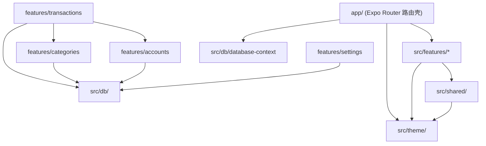

# 系统架构与模块边界说明

- **状态**：参考
- **影响范围**：全项目（`app/`、`src/`）
- **生效版本**：v1.1.2

## 结论概览

本应用采用「按业务职责组织模块 + 薄路由入口 + 单一本地 SQLite 事务层」的架构，核心目标是保证变更局部性：当收支规则、资产汇总口径或分类管理变化时，改动收敛在对应职责目录内，不波及无关模块。

## 目录与职责索引

| 目录 | 为何存在 | 负责什么 | 不负责什么 | 允许谁依赖 |
| --- | --- | --- | --- | --- |
| `app/` | Expo Router 文件路由入口 | 导航装配、参数读取、页面壳 | SQL 访问、业务校验、余额计算 | 仅 Expo Router 运行时 |
| `src/features/transactions/` | 收支与转账核心职责 | 支出/收入/转账记账、编辑删除、余额联动规则、按月流水与日分组汇总、记账表单与明细组件 | 账户净资产汇总、分类 CRUD | `app/`、`analytics`、`export` |
| `src/features/accounts/` | 资产与负债账户职责 | 账户增改、归档恢复、余额校准、总资产/总负债/净资产汇总规则、资产页组件 | 交易流水写入、分类规则 | `app/`、`transactions`、`export` |
| `src/features/categories/` | 收支分类职责 | 预设分类种子、居中弹窗新增/编辑、长按拖拽同级排序、左滑/删除账务原子迁移、分类树独立 JSON 校验增量/覆盖导入导出 | 账目记账、账户余额 | `app/`、`transactions`、`quick-record`、`export` |
| `src/features/quick-record/` | 快捷记账半屏窗与扇形极速入口职责 | 自定义快捷模板 CRUD、近 30 天高频推荐聚合、底栏长按 `+` 扇形滑选浮层、单卡 3 秒圆环倒计时原地撤销、单卡长按调金额/切账户（顶层半透明 HUD）与全屏复用记一笔 UI 编辑器 | 完整记账日期/备注/转账、报表分析 | `app/(tabs)/`、`export` |
| `src/features/analytics/` | 多周期账务分析职责 | 分类占比排行、账户资金分布、日均支出、结余率与月/年/全量收支趋势聚合 | 交易写入、余额变更 | `app/` |
| `src/features/export/` | 完整 JSON 备份导入导出职责 | Schema v3 完整 JSON 备份（含外观/账户/分类/快捷模板/明细与 FNV-1a 校验指纹）生成、严格校验、单事务原子恢复及 Android 原生文件读写 | 单笔业务记账规则 | `app/` |
| `src/features/settings/` | 应用设置、侧边抽屉与安全门禁职责 | 极简设置抽屉（顶栏右侧纯「i」关于图标、置顶外观切换持久化、分类管理、高级设置、底部版本号）、4 位随机数字验证码清空账本弹窗与配置仓储 | 核心账目与资产业务规则 | `app/`、`export` |
| `src/features/navigation/` | 主导航路由与共享顶栏上下文职责 | Expo Router 双页 Tab 占位描述符补齐、固定顺序规范化纯逻辑及主界面共享顶栏/抽屉上下文 | 具体页面渲染与业务规则 | `app/(tabs)/` |
| `src/db/` | 本地数据库基础设施 | `SqlExecutor` 契约、Schema v4 迁移（含 `app_settings` 与 `quick_templates`）、幂等默认单一钱包与分类种子、Expo/Node 适配器、变更通知上下文 | 业务领域校验与汇总计算 | `app/`、`src/features/*` |
| `src/shared/` | 跨职责通用底层原语 | 金额「分」解析格式化、日期月份工具、FNV-1a 校验指纹、分层 Haptics 震动封装、9 主题 146 项双图库图标目录、异形屏 `SafeScreen`、可拖拽 `BottomSheet` / 统一滑动分段控件 `SlidingSegmentedControl` / 弹窗原子 | 任何记账或资产业务规则 | 全项目 |
| `src/theme/` | 设计令牌与主题系统 | 浅色/深色语义配色、排版、间距、圆角、阴影、系统主题跟随 | 业务逻辑与数据读写 | `app/`、`src/features/*`、`src/shared/ui/` |

## 依赖方向约束

硬性边界：

1. `accounts` 与 `categories` 互相独立，且禁止反向依赖 `transactions`。
2. `shared/` 禁止依赖 `features/` 或 `db/`。
3. `app/` 路由文件禁止直接执行 SQL 或绕过 `service` 修改余额。

## 核心规则权威归属索引

| 规则 | 权威定义位置 | 执行位置 | 影响方 | 验证测试 |
| --- | --- | --- | --- | --- |
| 金额以整数「分」存储、上限与千分位格式化 | `src/shared/money/money.ts` | 全部表单与展示组件 | 全项目 | `src/shared/money/money.test.ts` |
| 业务日期（`YYYY-MM-DD`）与月度归属（`YYYY-MM`） | `src/shared/date/date.ts` | 明细筛选、记账日期、日分组 | `transactions` | `src/shared/date/date.test.ts` |
| 交易余额增量计算（支出扣减、收入与退款增加、转账一减一增）与关联退款上限/连带回滚约束 | `src/features/transactions/rules.ts` | `src/features/transactions/service.ts` 事务内 | `accounts` 余额、`transactions` | `src/features/transactions/rules.test.ts`、`service.test.ts` |
| 月度收支结余汇总（转账不计入支出/收入，退款抵扣当月净支出） | `src/features/transactions/rules.ts` | 明细页月度总览与账务分析 | `transactions`、`analytics` | `src/features/transactions/rules.test.ts`、`analytics/service.test.ts` |
| 总资产、总负债与净资产汇总（负债欠款以负数净值存储） | `src/features/accounts/rules.ts` | 资产页总览与账户调账 | `accounts` | `src/features/accounts/rules.test.ts`、`service.test.ts` |
| 分类删除保护（已被账目引用时仅允许归档停用）与两级层级约束 | `src/features/categories/rules.ts` | `src/features/categories/service.ts` | `categories`、`transactions`、`analytics` | `src/features/categories/rules.test.ts`、`service.test.ts` |
| 记账金额键盘表达式解析与分精度加减求值 | `src/features/transactions/amount-expression.ts` | `app/record.tsx`、`RecordKeypad.tsx` | `transactions` | `src/features/transactions/amount-expression.test.ts` |
| 收支分类账户记忆四层回退规则（精确分类 → 一级大类 → 同收支类型 → 默认首活跃账户）与单次手动锁定策略 | `src/features/transactions/rules.ts` | `src/features/transactions/repository.ts`、`app/record.tsx` | `transactions` | `src/features/transactions/rules.test.ts`、`service.test.ts` |
| 账务分析分类占比按一级分类聚合（二级并入所属一级） | `src/features/analytics/rules.ts` | `src/features/analytics/service.ts` | `analytics` | `src/features/analytics/rules.test.ts`、`service.test.ts` |

## 用例导航索引

| 用例 | 入口路由 | 服务编排 | 规则与仓储 | 自动化测试 |
| --- | --- | --- | --- | --- |
| UC-01 记一笔（支出/收入/转账） | `app/record.tsx` | `transactions/service.ts` (`createTransaction`) | `transactions/rules.ts`、`repository.ts` | `transactions/service.test.ts` |
| UC-02 编辑/删除账目并回滚重算余额 | `app/record.tsx` | `transactions/service.ts` (`updateTransaction` / `deleteTransaction`) | `transactions/rules.ts`、`repository.ts` | `transactions/service.test.ts` |
| UC-03 按月/按年/全部查看流水与周期汇总 | `app/(tabs)/index.tsx` | `transactions/service.ts` (`getMonthlyLedger` / `getYearlyLedger` / `getAllLedger`) | `transactions/rules.ts`、`repository.ts` | `transactions/service.test.ts` |
| UC-04 资产与负债账户管理及净资产汇总 | `app/(tabs)/assets.tsx`、`app/account-form.tsx` | `accounts/service.ts` | `accounts/rules.ts`、`repository.ts` | `accounts/service.test.ts` |
| UC-05 账户详情、流水筛选与手动调账 | `app/account-detail.tsx` | `accounts/service.ts` (`adjustAccountBalance`)、`transactions/service.ts` | `accounts/rules.ts` | `accounts/service.test.ts` |
| UC-06 分类管理（排序、迁移删除、独立 JSON 导入导出） | `app/categories.tsx` | `categories/service.ts`、`categories/portability.ts` | `categories/rules.ts`、`repository.ts` | `categories/service.test.ts` |
| UC-07 侧边抽屉设置、关于页、高级设置与验证码清空账本 | `app/(tabs)/_layout.tsx`、`app/about.tsx`、`app/advanced-settings.tsx` | `settings/components/SettingsDrawer.tsx`、`SettingsPanel.tsx`、`ClearLedgerDialog.tsx`、`db/seed.ts` | `settings/repository.ts`、`db/schema.ts` | `src/db/schema.test.ts` |
| UC-08 多周期账务分析（按月/按年/全部、分类占比、趋势与账户分布） | `app/analytics.tsx`（点击明细顶部总览卡进入） | `analytics/service.ts` (`getScopedAnalytics` / `getMonthlyAnalytics`) | `analytics/rules.ts` | `analytics/rules.test.ts`、`service.test.ts` |
| UC-09 完整 JSON 备份导出与校验原子导入恢复 | `app/advanced-settings.tsx` | `export/service.ts`、`export/native-io.ts` | `export/formatter.ts`、`shared/integrity/checksum.ts` | `export/formatter.test.ts`、`service.test.ts` |
| UC-10 底栏上滑快捷记账半屏窗、长按 `+` 扇形极速记账与原地 3 秒倒计时撤销 | `app/(tabs)/_layout.tsx` | `quick-record/components/QuickRecordSheet.tsx`、`QuickRadialOverlay.tsx`、`quick-record/service.ts` | `quick-record/repository.ts`、`scrub-rules.ts`、`radial-menu-rules.ts` | `quick-record/service.test.ts`、`scrub-rules.test.ts`、`radial-menu-rules.test.ts` |

## 变更场景模拟验证

1. **修改核心规则（如转账收取手续费）**：目标职责为 `features/transactions/`；仅需更新 `transactions/types.ts`、`transactions/rules.ts` 余额增量规则、`transactions/repository.ts` 与 `app/record.tsx` 表单输入；`accounts/rules.ts` 与 `categories/` 无需附带修改。
2. **新增用例（如月度分类占比统计页）**：在 `features/transactions/` 新增聚合查询与视图或新建 `features/statistics/` 只读消费 `transactions` 仓储接口；不改动记账写入事务与账户余额逻辑。
3. **替换底层存储驱动（如切换加密 SQLite）**：仅需新增实现 `src/db/types.ts` 中 `SqlExecutor` 接口的适配器并替换 `src/db/expo-client.ts`；全部 `features/*` 业务代码与单测零改动。
4. **修改数据结构（如账户新增信用额度字段）**：在 `src/db/schema.ts` 递增迁移版本号并新增列，更新 `features/accounts/` 内类型、仓储与表单组件；`transactions` 与 `categories` 无附带修改。
5. **修改 UI 配色或深色模式策略**：仅调整 `src/theme/palette.ts` 与 `src/theme/tokens.ts` 语义令牌映射；所有业务组件引用语义令牌，无需逐页硬改色值。
6. **新增独立功能（如周期性预算管理）**：新增 `src/features/budgets/` 职责目录，通过只读接口读取分类与月度支出汇总，不侵入记账核心写入逻辑。
